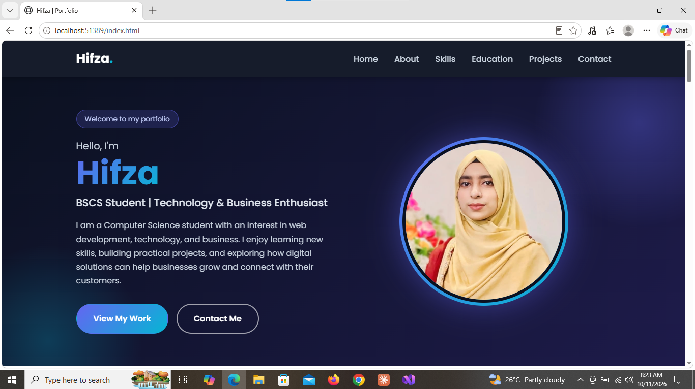
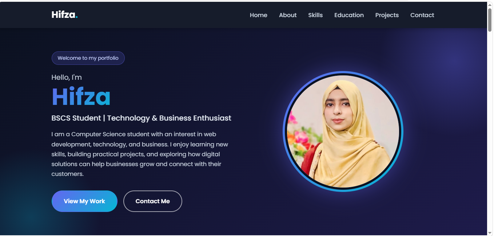
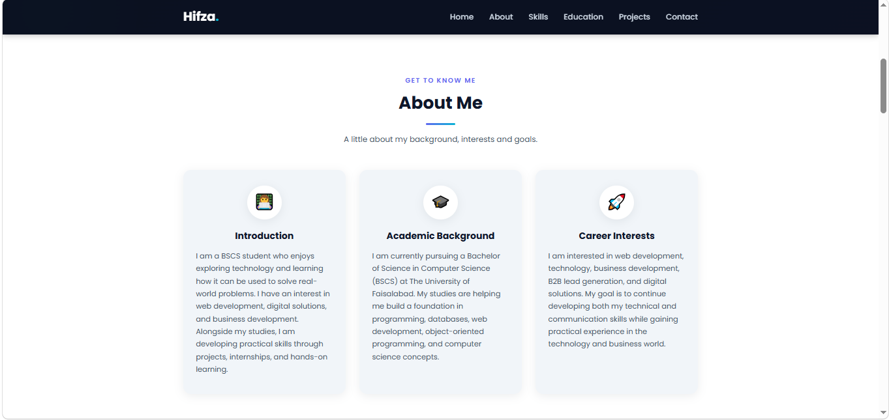
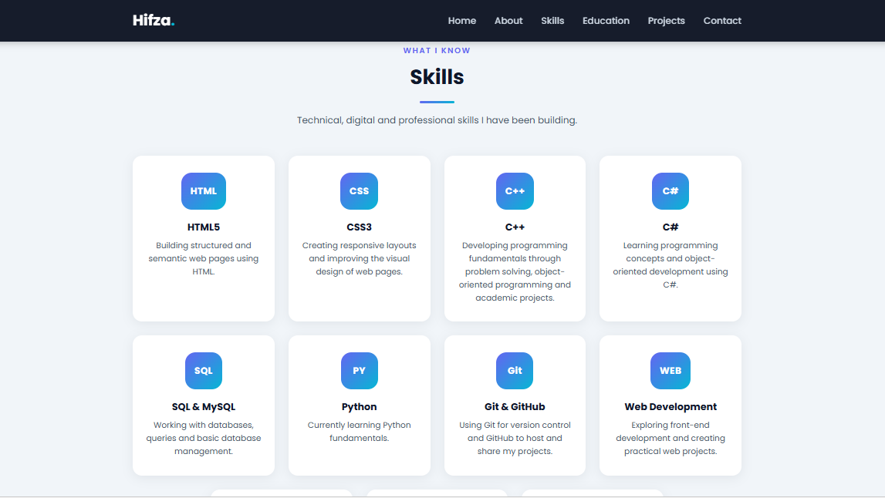
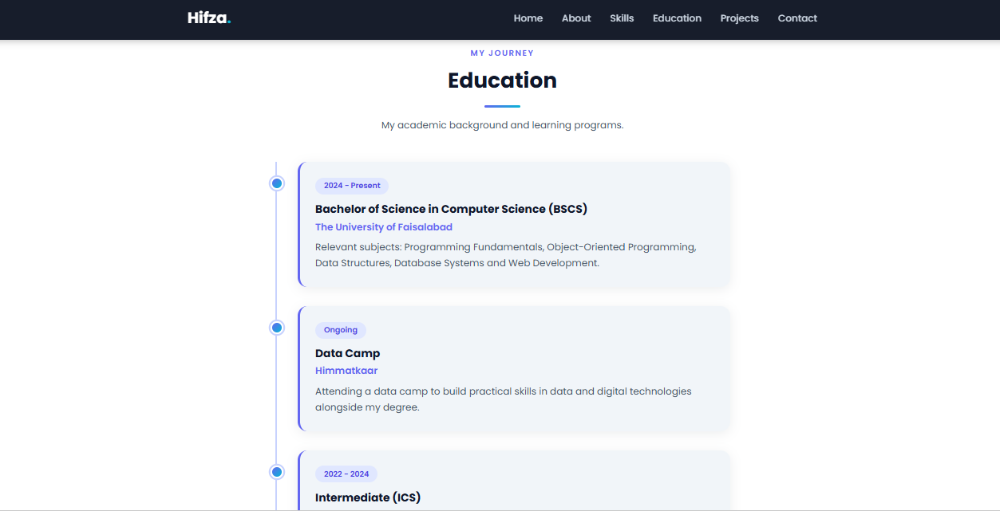
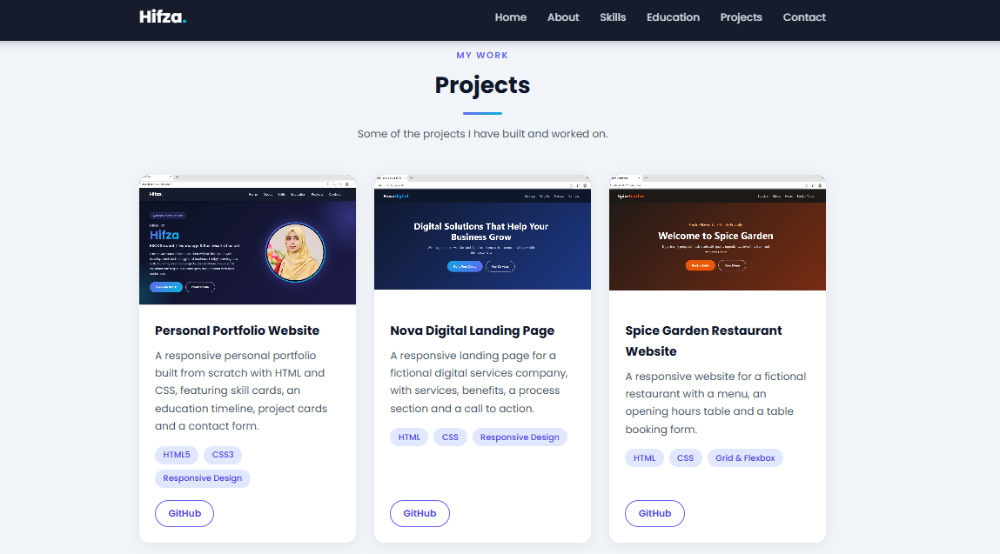
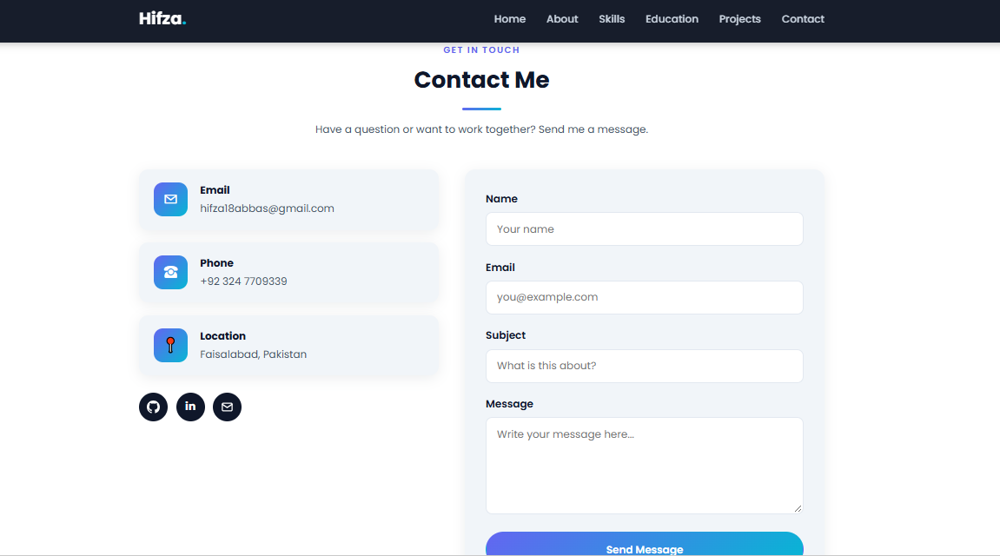
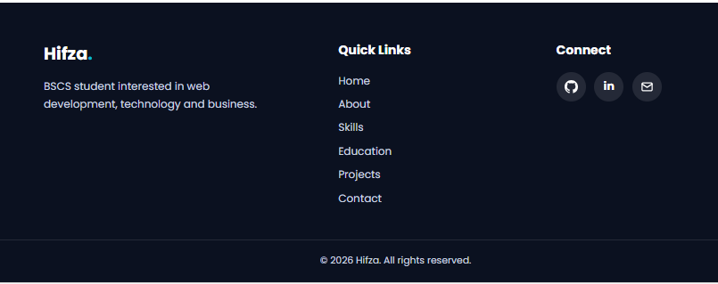
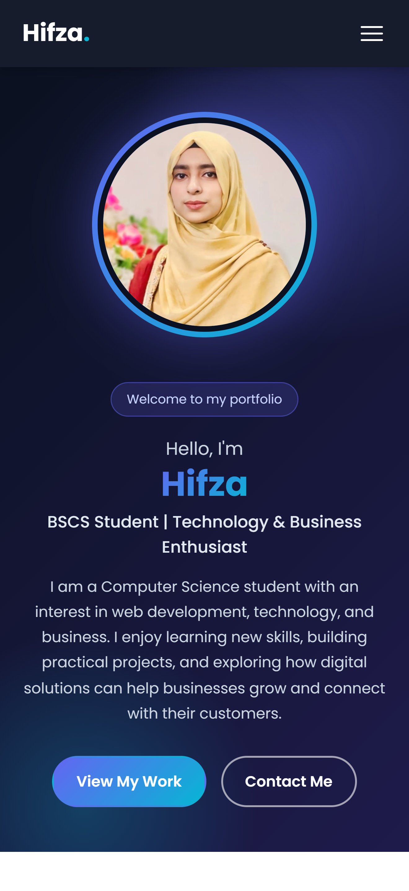

# Personal Portfolio Website

A modern, professional and fully responsive personal portfolio website built from scratch using **HTML5** and **CSS3**.

This project is **Task 01** of the **Devixo Solutions Web Development Internship Program**.

## Project Description

This portfolio website presents my personal profile, technical skills, education, projects and contact information through a clean and attractive web interface. The whole website is designed and styled using my own HTML and CSS code, without any CSS framework or downloaded template.

## Technologies Used

- HTML5 (semantic elements)
- CSS3 (Flexbox, Grid, media queries, transitions and animations)
- Google Fonts (Poppins)

No Bootstrap, Tailwind CSS, UI frameworks or website templates were used.

## Website Features

- Fully responsive design for desktop, laptop, tablet and mobile
- Sticky navigation bar with a mobile hamburger menu
- Smooth scrolling between sections
- Hero section with name, tagline, short introduction, profile image and call-to-action buttons
- About section with introduction, academic background and career interests
- Skills section with attractive skill cards
- Education section designed as a timeline
- Projects section with project cards (image, description, technologies and GitHub link)
- Contact section with contact details, social links and a contact form UI
- Footer with copyright, social links and quick navigation links
- Hover animations on buttons, navigation links, skill cards, project cards and social icons
- Consistent colour theme, readable typography and clean spacing

## Website Sections

1. Home
2. About
3. Skills
4. Education
5. Projects
6. Contact

## Project Structure

```
portfolio/
├── index.html
├── style.css
├── README.md
├── report.pdf
├── images/
│   ├── profile.jpg
│   ├── project1.jpg
│   └── project2.jpg
└── screenshots/
    ├── desktop-view.png
    ├── home-desktop.png
    ├── about-desktop.png
    ├── skills-desktop.png
    ├── education-desktop.png
    ├── projects-desktop.png
    ├── contact-desktop.png
    ├── footer-desktop.png
    └── mobile-view.png
```

## Screenshots

### Desktop View


### Home / Hero Section


### About Section


### Skills Section


### Education Section


### Projects Section


### Contact Section


### Footer


### Mobile View


## How to Run the Website

1. Download or clone this repository:
```
   git clone https://github.com/hifza18abbas-maker/portfolio-website.git
```
2. Open the `portfolio-website` folder.
3. Double-click `index.html` to open the website in your browser.

No installation or internet connection is needed to view the main pages (an internet connection is only used to load the Google Font).

## Author

**Hifza**
BSCS Student, The University of Faisalabad

- Email: hifza18abbas@gmail.com
- GitHub: [hifza18abbas-maker](https://github.com/hifza18abbas-maker)
- LinkedIn: [Hifza Abbas](https://www.linkedin.com/in/hifza-abbas-531090429)